# ERP FitnessTN

Caisse, ventes, devis, factures & bons de livraison, stock multi-sites, livraisons & transporteurs, tâches (Kanban), marketing, finances et import/export CSV — pour les showrooms de Tunis et de Nabeul.

**▶ Démo en ligne : https://contactnasriimen-ctrl.github.io/fitnesstn-erp/** — comptes de démonstration : `admin` / `ftn-3a44ca`, `tunis` / `ftn-cdc467`, `nabeul` / `ftn-14509e`, `marketing` / `ftn-6473e3`, `livreur` / `ftn-76b68c`.
La démo fait tourner ce code PHP dans le navigateur (PHP 8.3 WebAssembly) : les essais restent dans le navigateur de chacun. Pour l’utilisation réelle à plusieurs, installez l’ERP sur un hébergement PHP (voir plus bas).

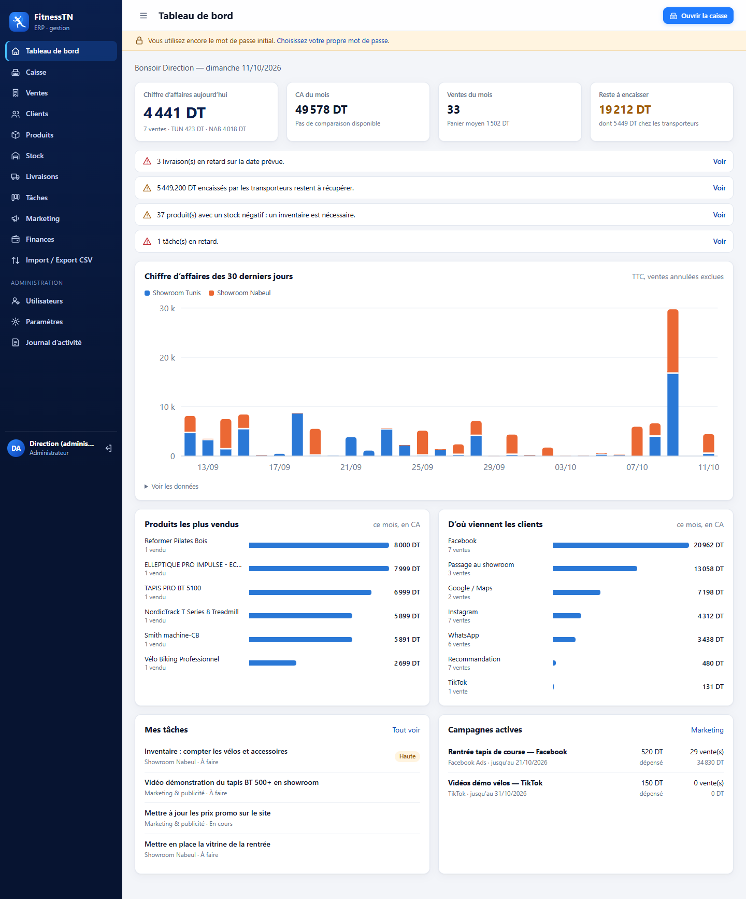

| Caisse | Encaissement |
|---|---|
| 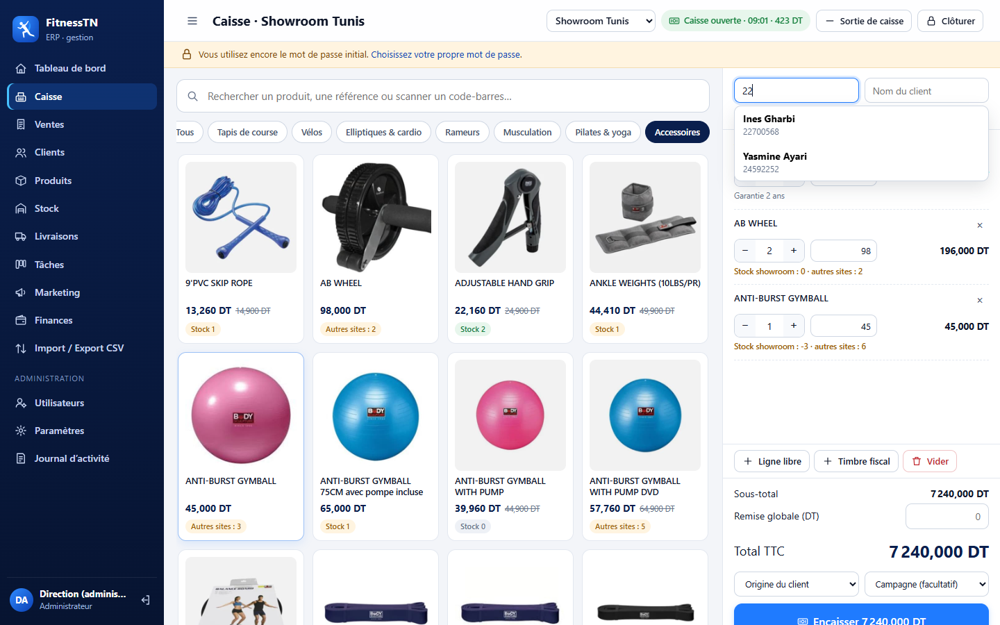 | 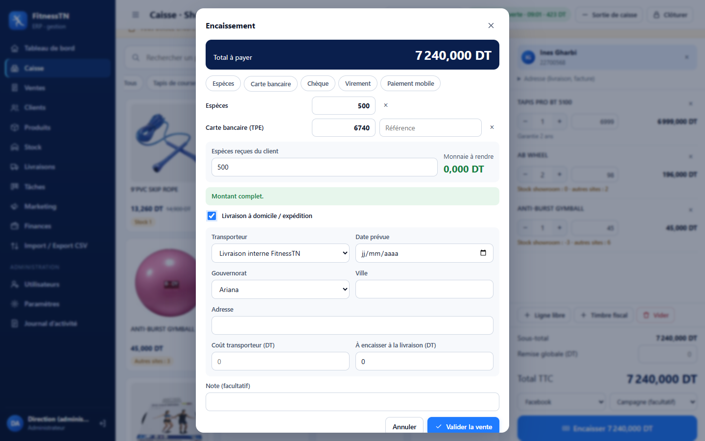 |
| **Tâches (Kanban)** | **Finances** |
| 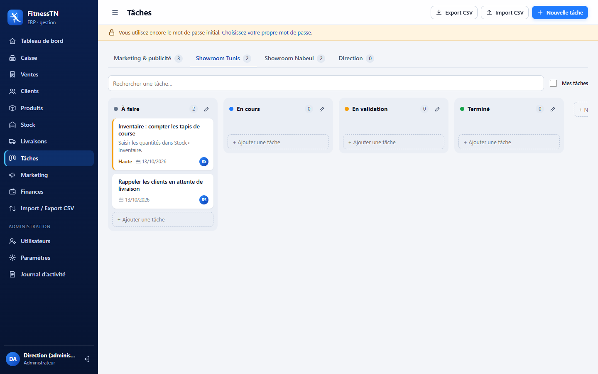 | 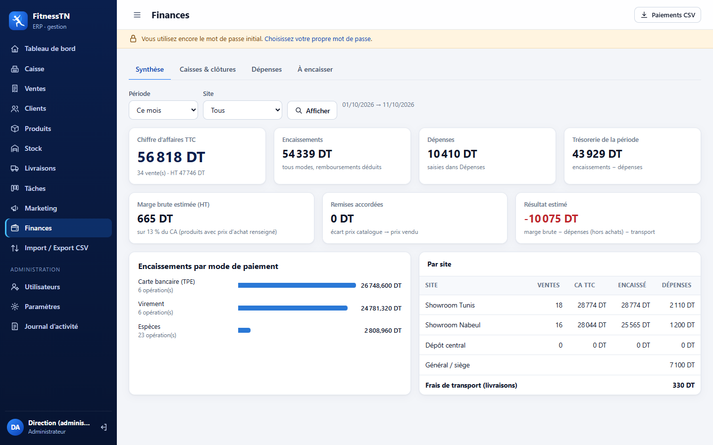 |
| **Stock** | **Livraisons** |
| 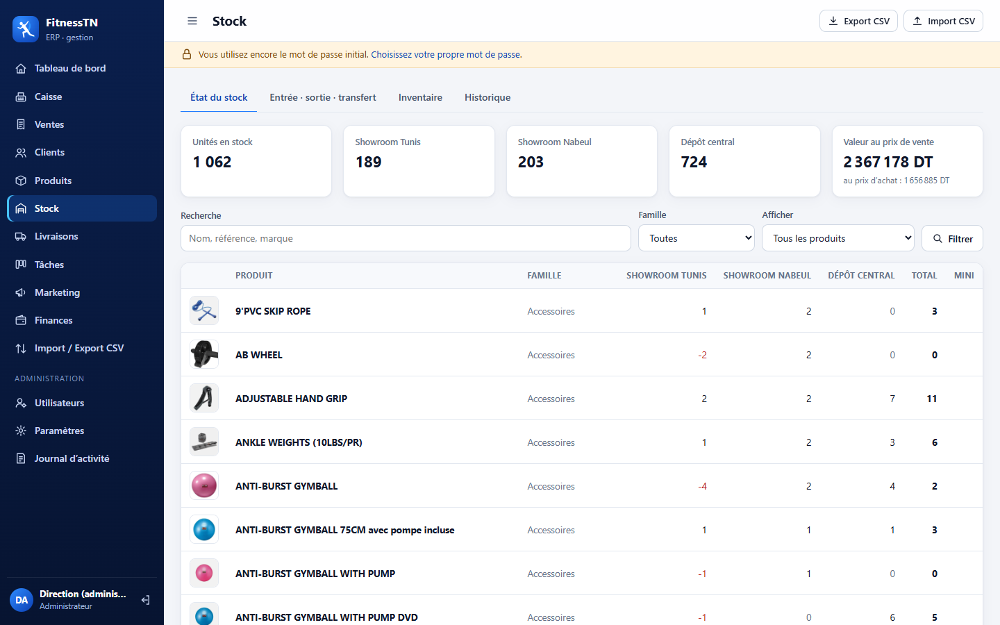 | 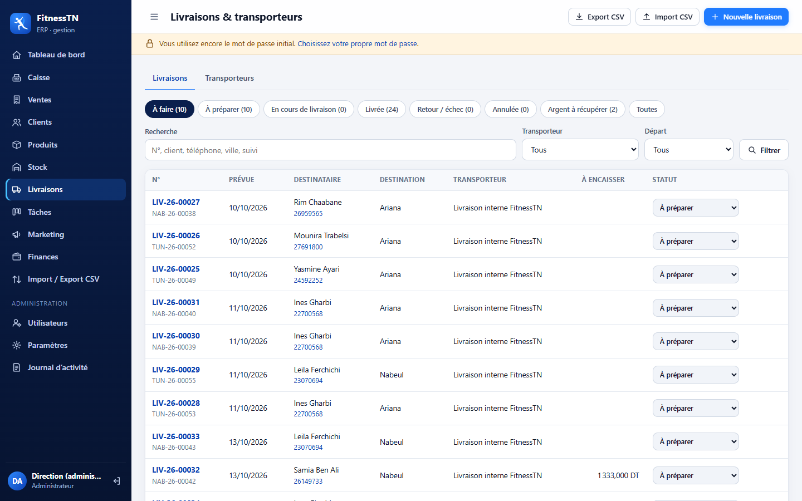 |
| **Campagnes marketing** | **Import / Export CSV** |
| 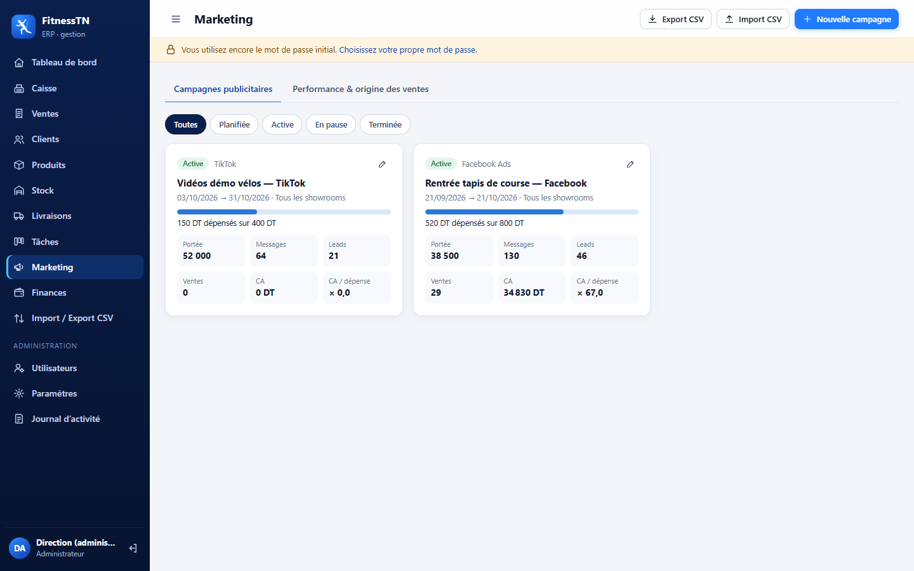 | 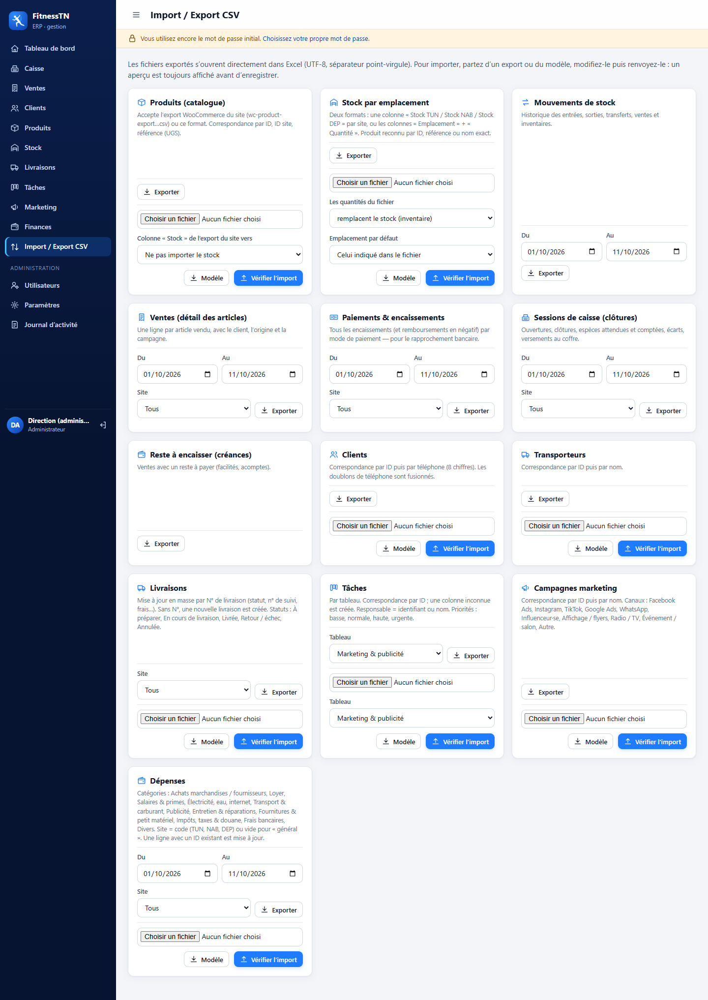 |
| **Ticket 80 mm** | **Facture A4** |
| 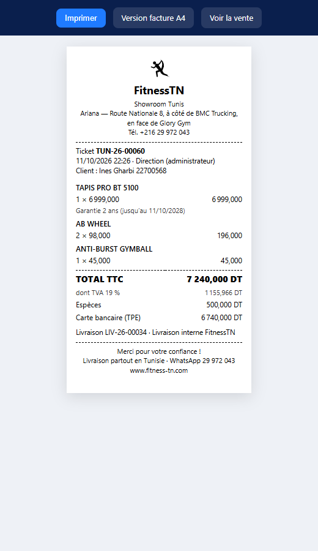 | 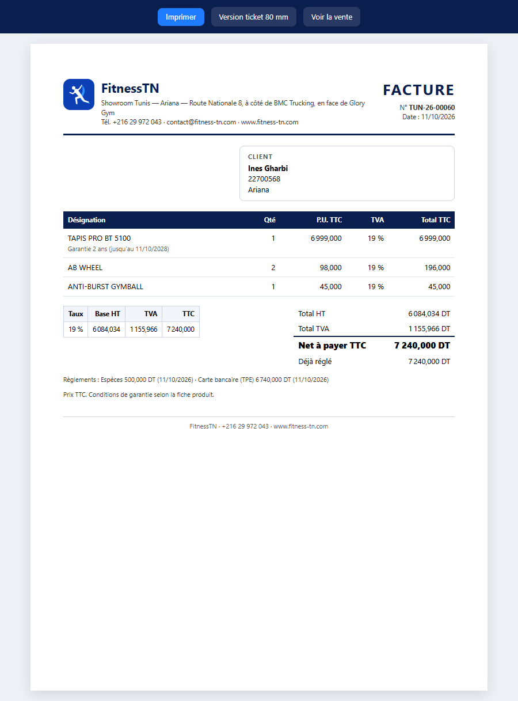 |

*Captures réalisées avec des données de démonstration fictives.*

## Démarrer

Double-cliquez sur **`start.bat`** : le navigateur s’ouvre sur http://localhost:8093.
Gardez la fenêtre noire ouverte pendant l’utilisation.

Au tout premier lancement, la base `data/erp.sqlite` est créée, les **182 produits** du site (export WooCommerce du 11/10/2026) sont importés avec leurs photos, et les comptes de départ sont écrits dans **`data/IDENTIFIANTS.txt`** (dossier protégé).

| Identifiant | Rôle |
|---|---|
| `admin` | Administrateur (direction) |
| `tunis` | Responsable showroom Tunis |
| `nabeul` | Responsable showroom Nabeul |
| `marketing` | Marketing & publicité |

Chacun change son mot de passe dans **Mon compte**. L’administrateur peut créer d’autres comptes et réinitialiser les mots de passe (menu Utilisateurs).

## Qui voit quoi

- **Administrateur** : tout, les deux showrooms, marges et prix d’achat, annulation des ventes, utilisateurs, paramètres, journal d’activité.
- **Responsable showroom** : caisse, ventes, clôtures, dépenses, livraisons et réparations & SAV de *son* showroom ; stock de tous les sites (mouvements pour le sien) ; clients ; tâches de son showroom.
- **Livreur** : livraisons de tous les showrooms (statut seulement), réparations, ventes, devis, factures, clients, produits et stock en consultation.
- **X (assistant IA)** : administrateur uniquement.
- **Marketing** : campagnes (budget, leads, ventes générées, CA/dépense), statistiques d’origine des ventes, tâches marketing, catalogue et clients en lecture.

## Les modules

- **Caisse** : ouverture avec fond de caisse, recherche / scan code-barres, prix promo automatiques, prix « sur devis » saisi en caisse, remise (plafonnée à 20 % pour les responsables), paiements multiples (espèces avec monnaie à rendre, carte, chèque, virement, D17/Flouci), reste à payer (facilité), livraison avec paiement à la livraison, ticket 80 mm et facture A4, sorties de caisse, clôture avec billetage et rapport Z.
- **Devis & factures** : saisie avec recherche client / produit, prix HT ou TTC au choix, remise par ligne ou globale, TVA par ligne, timbre fiscal, montant en lettres. Suivi des devis (brouillon, envoyé, accepté, refusé), transformation en facture en un clic, facture établie depuis une vente de caisse. Paiements partiels, relances (factures en retard, devis expirés), envoi par WhatsApp, impression / PDF A4 avec coordonnées bancaires et avertissement de garantie FR / AR. Numérotation 000019/26 continuable depuis les factures papier. Cachet et signature imprimés sur les documents. Les paiements de factures comptent dans les Finances, et ceux en espèces dans la caisse ouverte du showroom (clôture). Relance WhatsApp des factures impayées depuis Finances › À encaisser ; la caisse propose la facture officielle à la fin d’une vente.
- **Stock** : par showroom et dépôt, entrées / sorties / transferts sur plusieurs lignes, inventaire, historique de tous les mouvements.
- **Livraisons & transporteurs** : trajet (départ → gouvernorat / adresse d’arrivée), marchandise transportée, **où est la marchandise maintenant** (au dépôt, chez le transporteur, chez le technicien, chez le client, en retour — mis à jour avec le statut), historique de chaque étape, technicien / installateur et sa prime, transport payé par le client, coût du transporteur, n° de suivi, argent encaissé chez les clients et encore à récupérer auprès des transporteurs. Le gouvernorat est deviné d’après l’adresse.
- **Réparations & SAV** : demandes des clients (machine, panne, réparation payante ou SAV sous garantie, à domicile ou à l’atelier), réparateur, rendez-vous, statut (nouvelle, en cours, réparée, annulée), montant et encaissement, message WhatsApp au client selon l’étape. Le client est retrouvé par son téléphone, avec ses achats et ses réparations précédentes.
- **X — assistant IA** (administrateur) : répond aux questions sur les données (chiffre d’affaires, produits, transporteurs, livraisons et retours, réparations & SAV, techniciens, clients, gouvernorats, stock, dépenses, paiements, reste à encaisser, bilan), avec la période voulue (« en octobre », « le mois dernier », « depuis mars »…) ; comprend aussi quelques mots en tunisien. Tout est calculé dans l’ERP : aucune connexion extérieure, ni clé, ni abonnement.
- **Tâches** : un tableau Kanban par équipe (Marketing, Showroom Tunis, Showroom Nabeul, Direction) ; tâches et colonnes modifiables, glisser-déposer.
- **Finances** : synthèse (CA, encaissements, dépenses, marge, résultat estimé), clôtures de caisse, dépenses, reste à encaisser.
- **Import / Export** : 16 jeux de données, ouverts directement par Excel ; les imports acceptent CSV et Excel (.xlsx). Chaque import montre un aperçu avant d’enregistrer. L’export WooCommerce du site est reconnu tel quel.
- **Vos fichiers Excel** (administrateur, Import / Export) : les classeurs « VENTE GRAND TUNIS » (une feuille par mois), « PAIEMENT » (transporteurs) et « RÉPARATION ET SERVICE APRÈS VENTE » s’importent tels quels. Ventes numérotées XL-26-…, sans toucher au stock ni aux caisses ; retours = ventes annulées ; paiements des transporteurs rapprochés des ventes. Un fichier complété peut être renvoyé : rien n’est dupliqué et les changements (payé, réparé…) sont mis à jour.
- **Bons de livraison** (v1.6) : même saisie que les factures, numérotation BL-000001/26, statuts « À livrer », « Livré », « Facturé ». Un bon s’établit directement ou depuis une facture, et se transforme en facture en un clic. Le stock ne sort qu’une fois, par le bon ou par la facture. Impression A4 avec ou sans les prix (copie du transporteur), avec les cases de signature du transporteur et du client.
- **Transporteur et modalité de paiement** (v1.6) : chaque devis, facture ou bon de livraison porte une modalité de paiement (comptant à la livraison, chèque, virement, traite…) et un transporteur (nom, matricule du véhicule, CIN du chauffeur), imprimés sur le document. Les deux listes se gèrent dans « Transporteurs & paiements » (bouton en haut des factures et des bons) : ajout, modification, suppression, ordre et modalité par défaut. Un document garde ce qui y est imprimé, même si la liste change ensuite.
- **Devis & factures** : le matricule fiscal de l’entreprise est imprimé dans un cadre « المعرف الجبائي / Matricule Fiscal » en haut de chaque document.

## Avant l’utilisation réelle

1. Paramètres : raison sociale, matricule fiscal, RIB, numérotation des factures, mentions de facture, fond de caisse, remise maximale (à valider avec l’expert-comptable).
2. Stock › Inventaire : saisir les quantités de chaque site (le stock part de zéro).
3. Produits : renseigner les prix d’achat pour obtenir les marges.
4. Une copie de la base est faite automatiquement chaque jour (14 jours conservés, Paramètres › Sauvegardes) ; téléchargez-en une chaque semaine pour la garder hors du serveur.

## Utiliser l’ERP depuis les deux showrooms

`start.bat` fonctionne sur un seul ordinateur. Pour que Tunis et Nabeul travaillent sur la même base, installez le dossier sur un hébergement **PHP 8 avec SQLite** (Apache ou LiteSpeed, en HTTPS), sans les dossiers `tests/` et `docs/`. Les fichiers `.htaccess` protègent `app/`, `data/` et `tools/`.

Après l’envoi des fichiers, ouvrez **`/check.php`** : la page vérifie PHP, SQLite, les droits d’écriture et que la base de données n’est pas téléchargeable. Tout doit être vert avant d’utiliser l’ERP.

## Sécurité et rapidité

- Connexion : mots de passe chiffrés (bcrypt), blocage après 8 essais ratés, même temps de réponse qu’un identifiant existe ou non, session renouvelée à chaque connexion et refus des identifiants de session inventés, **déconnexion automatique après 10 h sans activité**.
- Chaque page envoie des en-têtes de protection : politique de contenu (CSP : seuls les fichiers de l’ERP s’exécutent), anti-intégration dans un autre site, HTTPS imposé (HSTS) quand le site est en HTTPS, caméra / micro / position désactivés.
- Toutes les actions passent par un jeton anti-falsification (CSRF) ; la base, les sauvegardes, les dossiers `app/`, `data/`, `tools/`, `tests/` et les fichiers cachés (`.git`…) ne sont jamais servis ; aucun script ne peut s’exécuter depuis le dossier des fichiers envoyés.
- Pages compressées (5 à 10 fois plus légères), CSS / JS / images gardés en cache par le navigateur, index de base de données sur les listes et calculs (page Clients 7 fois plus rapide).

## Pour le développeur

- PHP 8.0+ (pdo_sqlite, mbstring), aucune dépendance. Montants stockés en millimes.
- `node tests/e2e.mjs` : 176 vérifications de bout en bout (base temporaire).
- X : `app/x_engine.php` (compréhension de la question : intention, période, produit, transporteur, technicien, gouvernorat, téléphone ; réponses par requêtes SQL fixes en lecture), page `app/pages/x.php`, script `assets/js/x.js`. La question précédente sert de contexte (« et en septembre ? »).
- `node tests/shots.mjs` : captures d’écran sur données de démonstration (`tests/out/`).
- Mot de passe oublié : `php tools/reset_password.php admin`.
