# ERP FitnessTN

Caisse, ventes, stock multi-sites, livraisons & transporteurs, tâches (Kanban), marketing, finances et import/export CSV — pour les showrooms de Tunis et de Nabeul.

**▶ Démo en ligne : https://contactnasriimen-ctrl.github.io/fitnesstn-erp/** — comptes `admin`, `tunis`, `nabeul`, `marketing`, mot de passe `demo2026`.
La démo fait tourner ce code PHP dans le navigateur (PHP 8.3 WebAssembly) : les essais restent dans le navigateur de chacun. Pour l’utilisation réelle à plusieurs, installez l’ERP sur un hébergement PHP (voir plus bas).

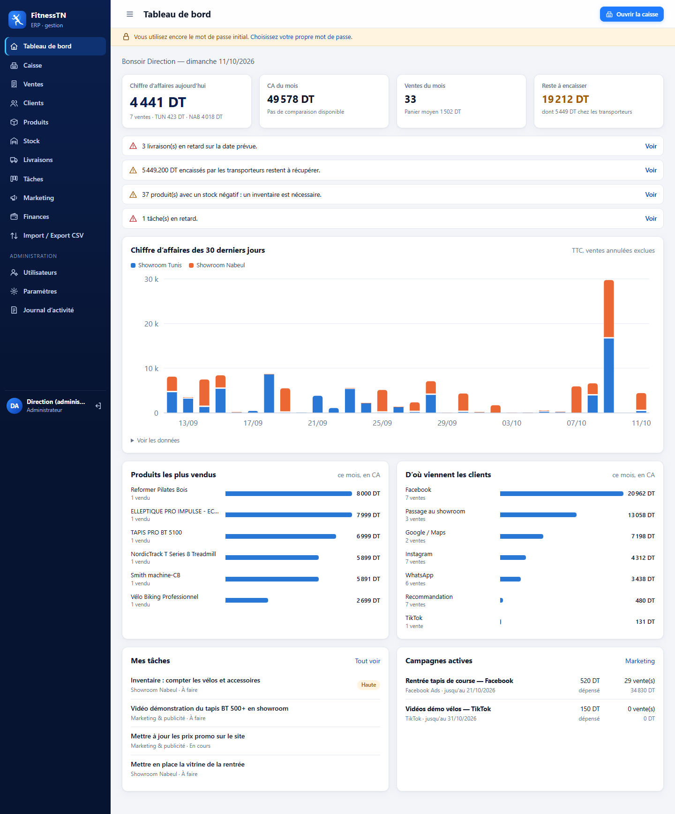

| Caisse | Encaissement |
|---|---|
| 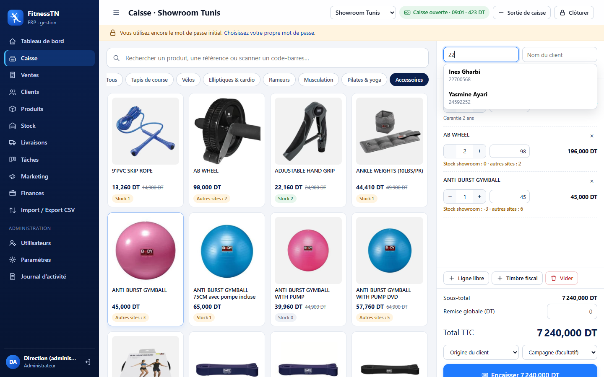 | 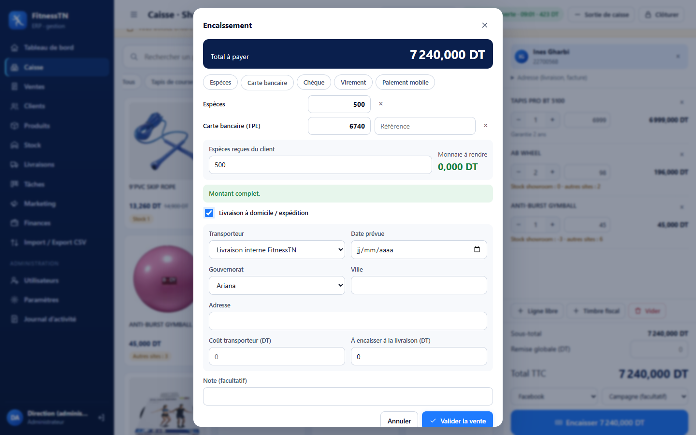 |
| **Tâches (Kanban)** | **Finances** |
| 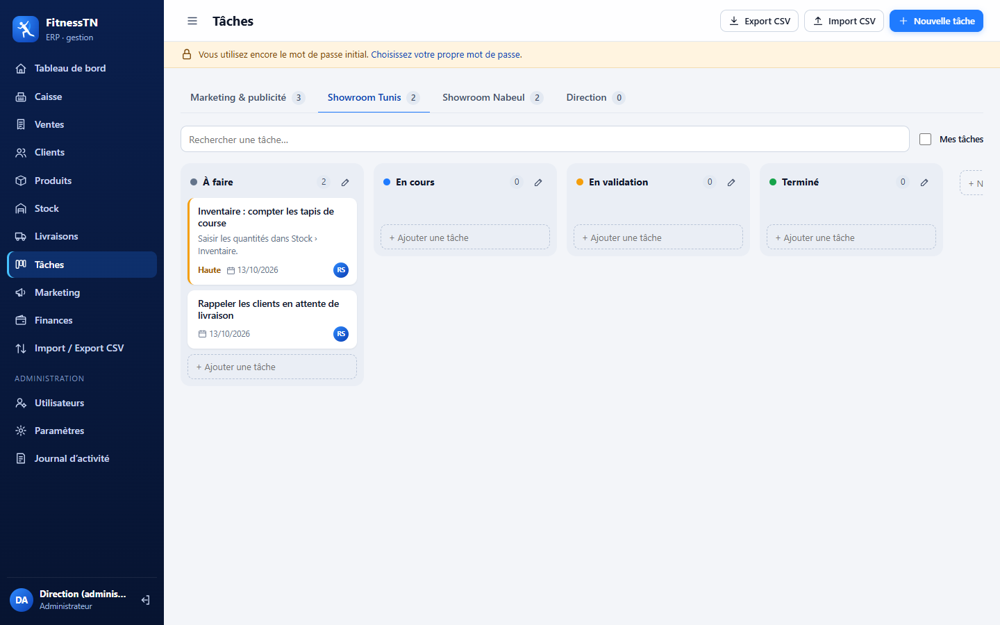 | 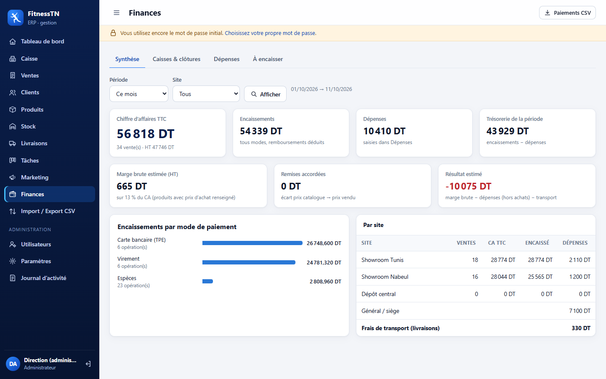 |
| **Stock** | **Livraisons** |
| 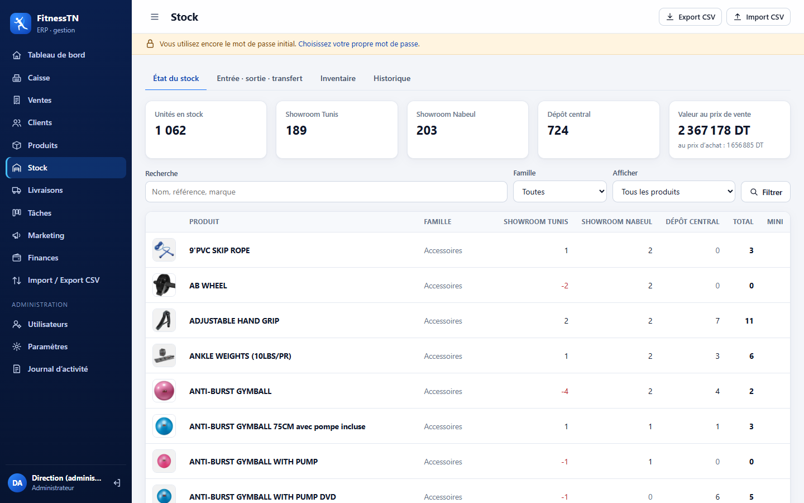 | 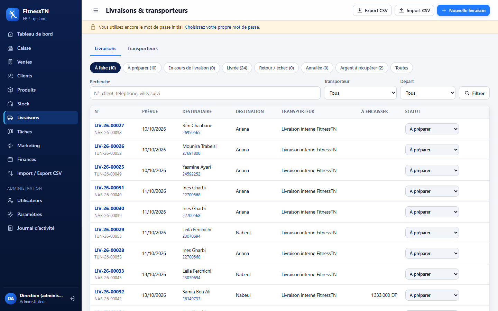 |
| **Campagnes marketing** | **Import / Export CSV** |
| 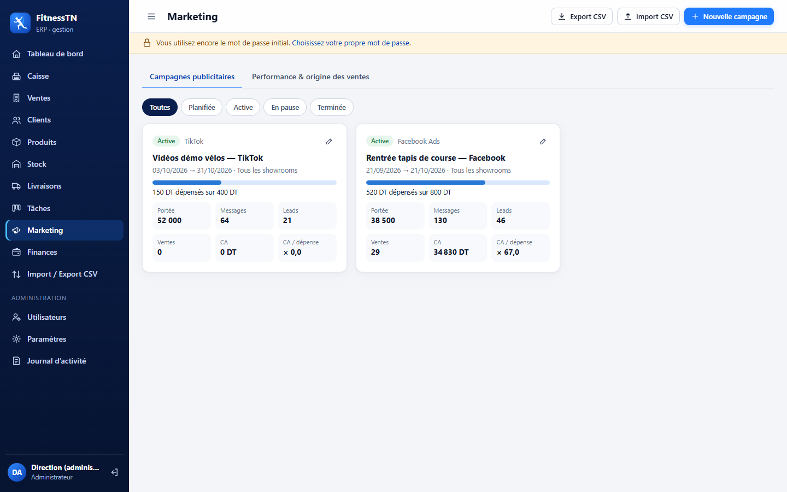 | 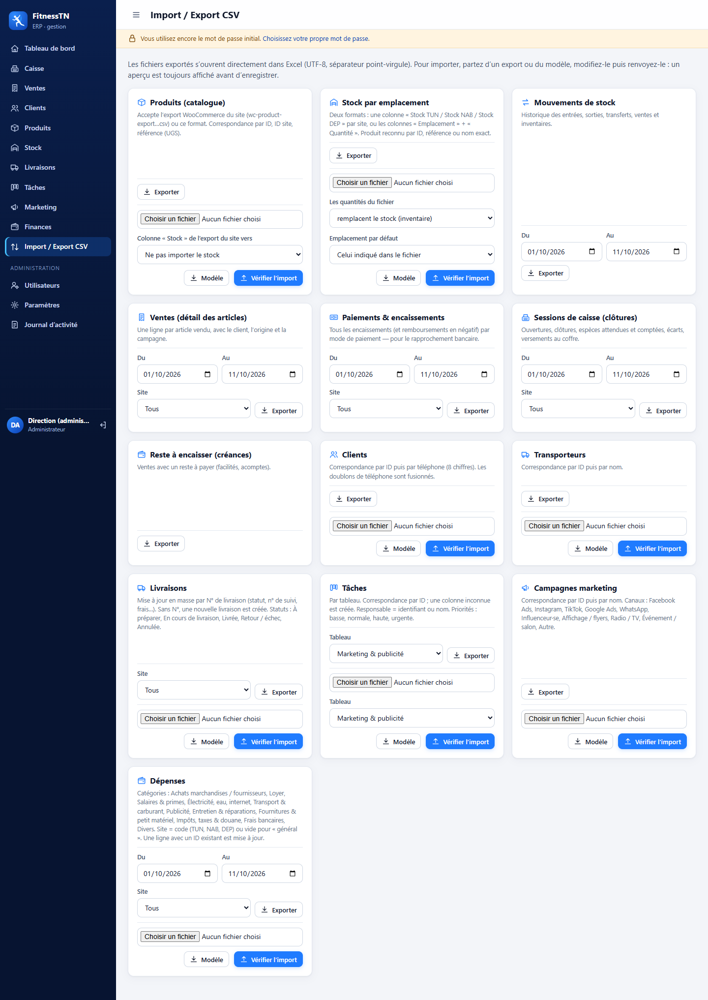 |
| **Ticket 80 mm** | **Facture A4** |
| 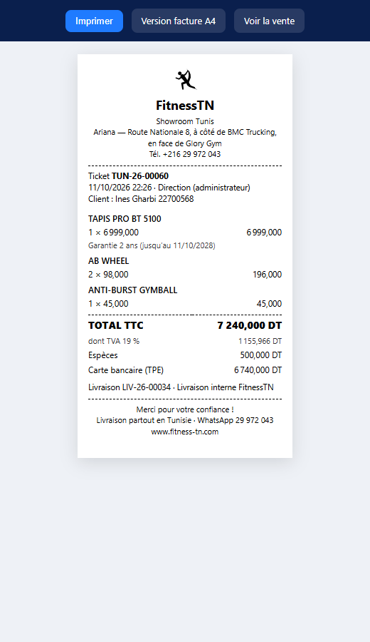 | 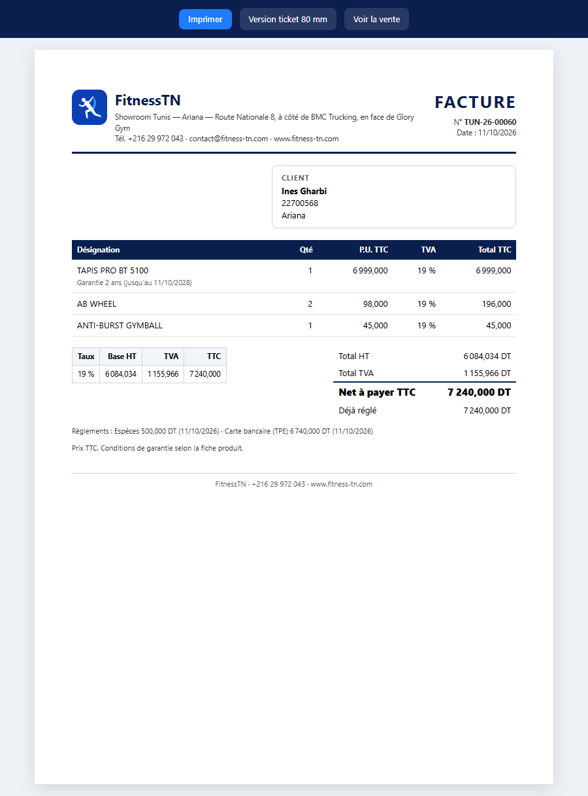 |

*Captures réalisées avec des données de démonstration fictives.*

## Démarrer

Double-cliquez sur **`start.bat`** : le navigateur s’ouvre sur http://localhost:8093.
Gardez la fenêtre noire ouverte pendant l’utilisation.

Au tout premier lancement, la base `data/erp.sqlite` est créée, les **182 produits** du site (export WooCommerce du 11/10/2026) sont importés avec leurs photos, et les comptes de départ sont écrits dans **`data/IDENTIFIANTS.txt`** (dossier protégé).

| Identifiant | Rôle |
|---|---|
| `admin` | Administrateur (direction) |
| `tunis` | Responsable showroom Tunis |
| `nabeul` | Responsable showroom Nabeul |
| `marketing` | Marketing & publicité |

Chacun change son mot de passe dans **Mon compte**. L’administrateur peut créer d’autres comptes et réinitialiser les mots de passe (menu Utilisateurs).

## Qui voit quoi

- **Administrateur** : tout, les deux showrooms, marges et prix d’achat, annulation des ventes, utilisateurs, paramètres, journal d’activité.
- **Responsable showroom** : caisse, ventes, clôtures, dépenses et livraisons de *son* showroom ; stock de tous les sites (mouvements pour le sien) ; clients ; tâches de son showroom.
- **Marketing** : campagnes (budget, leads, ventes générées, CA/dépense), statistiques d’origine des ventes, tâches marketing, catalogue et clients en lecture.

## Les modules

- **Caisse** : ouverture avec fond de caisse, recherche / scan code-barres, prix promo automatiques, prix « sur devis » saisi en caisse, remise (plafonnée à 20 % pour les responsables), paiements multiples (espèces avec monnaie à rendre, carte, chèque, virement, D17/Flouci), reste à payer (facilité), livraison avec paiement à la livraison, ticket 80 mm et facture A4, sorties de caisse, clôture avec billetage et rapport Z.
- **Stock** : par showroom et dépôt, entrées / sorties / transferts sur plusieurs lignes, inventaire, historique de tous les mouvements.
- **Livraisons & transporteurs** : statut, n° de suivi, coût, argent encaissé chez les clients et encore à récupérer auprès des transporteurs.
- **Tâches** : un tableau Kanban par équipe (Marketing, Showroom Tunis, Showroom Nabeul, Direction) ; tâches et colonnes modifiables, glisser-déposer.
- **Finances** : synthèse (CA, encaissements, dépenses, marge, résultat estimé), clôtures de caisse, dépenses, reste à encaisser.
- **Import / Export CSV** : 13 jeux de données, ouverts directement par Excel. Chaque import montre un aperçu avant d’enregistrer. L’export WooCommerce du site est reconnu tel quel.

## Avant l’utilisation réelle

1. Paramètres : matricule fiscal, mentions de facture, fond de caisse, remise maximale (à valider avec l’expert-comptable).
2. Stock › Inventaire : saisir les quantités de chaque site (le stock part de zéro).
3. Produits : renseigner les prix d’achat pour obtenir les marges.
4. Paramètres › Télécharger une sauvegarde, chaque semaine.

## Utiliser l’ERP depuis les deux showrooms

`start.bat` fonctionne sur un seul ordinateur. Pour que Tunis et Nabeul travaillent sur la même base, installez le dossier sur un hébergement **PHP 8 avec SQLite** (Apache ou LiteSpeed, en HTTPS), sans les dossiers `tests/` et `docs/`. Les fichiers `.htaccess` protègent `app/`, `data/` et `tools/`.

Après l’envoi des fichiers, ouvrez **`/check.php`** : la page vérifie PHP, SQLite, les droits d’écriture et que la base de données n’est pas téléchargeable. Tout doit être vert avant d’utiliser l’ERP.

## Pour le développeur

- PHP 8.0+ (pdo_sqlite, mbstring), aucune dépendance. Montants stockés en millimes.
- `node tests/e2e.mjs` : 107 vérifications de bout en bout (base temporaire).
- `node tests/shots.mjs` : captures d’écran sur données de démonstration (`tests/out/`).
- Mot de passe oublié : `php tools/reset_password.php admin`.
